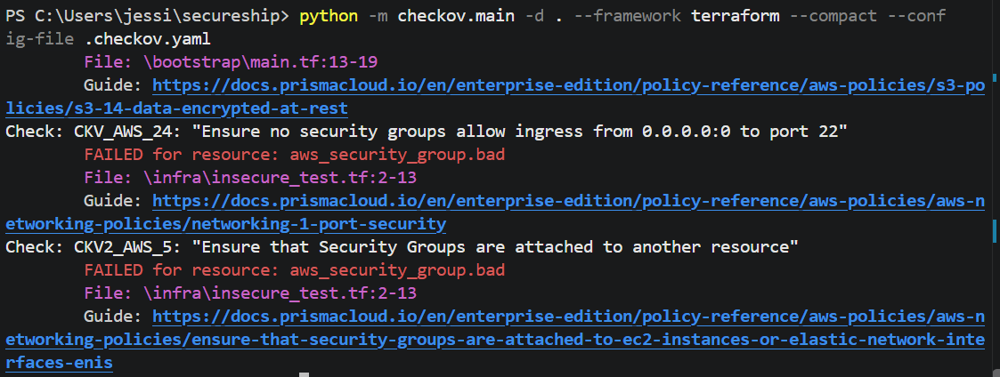

# secureship

A DevSecOps pipeline for deploying a serverless app on AWS, built with Terraform.

## Architecture
API Gateway → Lambda (Python) → DynamoDB

## Progress
- Day 1: Serverless API deployed with Terraform, using least-privilege IAM and SSO-based access (no long-lived keys) 

- Day 2: Remote Terraform state in S3 (versioned, encrypted, public access blocked, native locking)

- Day3: CI/CD with GitHub Actions — OIDC login (no stored AWS keys), automated fmt/validate/plan, auto-deploy on push to main

- Day4: Automated security scanning with a security gate
 - Checkov (Terraform misconfigurations) and Trivy (misconfigurations, secrets, vulnerabilities) run on every push and pull request
 - Deployment is blocked if any unaccepted or HIGH/CRITICAL finding is detected
 - Hardened infrastructure: DynamoDB point-in-time recovery and encryption, Lambda X-Ray tracing, API access logging, API rate limiting, 1-year log retention
 - Tightened pipeline permissions from `iam:*` to only the exact IAM actions Terraform needs
 - Accepted risks reviewed and documented (see below)

 ## Security gate in action
To prove the gate works, a pull request was opened that deliberately exposed SSH (port 22) to the whole internet. Checkov caught it, the security scan failed, and Terraform never ran, so the change was blocked from deploying.

## Accepted risks
Not every finding is worth fixing in a single-developer project. Each accepted risk is documented with a reason in `.checkov.yaml` and `.trivyignore`.

| Finding | Tool | Reason accepted |
|---|---|---|
| State bucket uses AES256, not a customer-managed KMS key (AWS-0132, HIGH) | Trivy | State is still encrypted; a dedicated KMS key adds cost with little benefit for a single-user project |
| Lambda not in a VPC | Checkov | Planned for the network design phase |
| No dead-letter queue on Lambda | Checkov | API is synchronous, so failures return straight to the caller |
| No reserved Lambda concurrency | Checkov | New account limit is too low; API Gateway throttling is used instead |
| API route has no authorisation | Checkov | Public demo API by design |
| AWS-managed encryption instead of customer keys (DynamoDB, logs, env vars) | Checkov | No sensitive data stored |
| No code signing | Checkov | Code is only deployed through the pipeline |
| No access logging, replication, lifecycle rules or event notifications on state bucket | Checkov | Low value for a small, single-user state bucket; versioning covers recovery |

## Next up
**Day 5: Threat detection and alerting**
- Enable CloudTrail to record all API activity in the account
- Enable GuardDuty for automated threat detection
- Send GuardDuty findings to email via EventBridge and SNS
- Add a CloudWatch alarm for Lambda errors
- Add a branch protection rule so pull requests can't be merged unless the security scan passes

**Later**
- Reorganise Terraform into reusable modules
- Add network design: VPC, private subnets, DynamoDB VPC endpoint, flow logs
- Update GitHub Actions versions to clear Node.js deprecation warnings